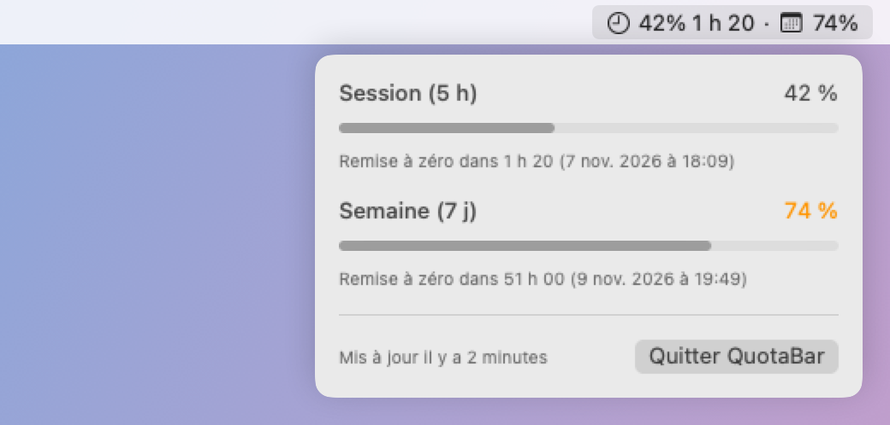

# quotabar

A tiny macOS menu bar app showing where you stand on your Claude Code plan limits: the 5-hour session window and the weekly window, with the time left before the session resets.



- The menu bar shows the session usage and the time before it resets (🕒), then the weekly usage (📅).
- The panel shows both windows with their reset time, orange from 70 % and red from 90 %.
- Once a reset time is past, the window goes back to 0 % without waiting for new data.

## How it works

Claude Code only shares the plan usage (`rate_limits`, Pro and Max plans) with the [status line](https://code.claude.com/docs/en/statusline) command. `scripts/statusline-relay.sh` sits in between: it saves that JSON to `~/Library/Application Support/quotabar/statusline.json`, then hands the same input to your real status line. quotabar reads that file every 5 seconds.

The values are the ones of your account, so they include your claude.ai usage, but they only refresh when Claude Code gets a response.

## Install

1. Copy the relay and make it executable:

   ```bash
   cp scripts/statusline-relay.sh ~/.claude/statusline-relay.sh
   chmod +x ~/.claude/statusline-relay.sh
   ```

2. If you already have a status line, move its command into `next_statusline()` in the copied script.

3. Point Claude Code to the relay in `~/.claude/settings.json`:

   ```json
   "statusLine": {
     "type": "command",
     "command": "~/.claude/statusline-relay.sh"
   }
   ```

4. Build and run the app (macOS 13+, Swift from the Xcode Command Line Tools):

   ```bash
   ./build.sh
   open QuotaBar.app
   ```

The numbers appear after the next Claude Code response.
